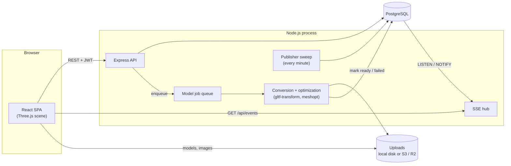
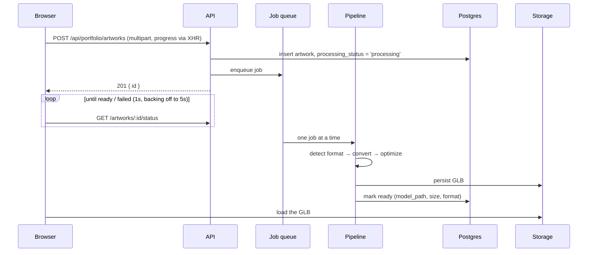

# Architecture

PortfolioDDD is a portfolio site for 3D artists. Artists upload models in whatever format their tools export. The server converts each one to an optimized glTF binary. Visitors browse the models in a 3D carousel and can open any of them in an inspector.

This document explains how the pieces fit together and why they're built the way they are. For setup, scripts and configuration, see the [README](../README.md).



## Contents

1. [Repository layout](#repository-layout)
2. [The model pipeline](#the-model-pipeline)
3. [The 3D viewer](#the-3d-viewer)
4. [Frontend application](#frontend-application)
5. [Backend](#backend)
6. [Direct messages](#direct-messages)
7. [Real-time events](#real-time-events)
8. [Storage, images and caching](#storage-images-and-caching)
9. [SEO and link previews](#seo-and-link-previews)
10. [Security](#security)
11. [Testing](#testing)
12. [Design decisions and trade-offs](#design-decisions-and-trade-offs)

## Repository layout

```
src/
├── App.tsx                  routing and page assembly
├── types/                   types shared by frontend and backend
├── frontend/
│   ├── components/
│   │   ├── Scene3D.tsx      the carousel/inspector scene (orchestration)
│   │   └── scene/           its hooks and overlays (viewport, carousel,
│   │                        focus mode, model jobs, saved-artwork loader)
│   ├── three/               pure Three.js logic: carousel layout, camera
│   │                        animation, saved views, scene helpers
│   ├── inspector/           ModelInspector (shading, texture channels),
│   │                        PostProcessing (tone mapping, AO, bloom)
│   ├── hooks/               auth, i18n, theme, and per-feature state
│   │                        (portfolio, public profile, comments, ...)
│   ├── realtime/            SSE client
│   └── utils/               API helpers, uploads, responsive images
└── backend/
    ├── app.ts               Express wiring
    ├── routes/ → controllers/ → repositories/
    ├── pipeline/            model conversion and optimization
    ├── services/            realtime, image resizing, publisher, mail
    ├── storage/             local / S3 driver
    ├── seo/                 page metadata, OG images, sitemap
    ├── middleware/          auth, rate limits, validation, noai
    ├── validation/          zod schemas
    └── db/migrations/       numbered SQL migrations
e2e/                         Playwright specs
.github/                     CI workflow (workflows/ci.yml) and Dependabot
```

## The model pipeline

Uploading models is the core of the product. Artists use Blender, Maya, ZBrush and Substance, each with its own export formats. Browsers need glTF, ideally compressed. The pipeline bridges the two on the server, so the client only ever loads a single kind of file.

### Flow



### Stages

1. **Format detection** ([`formats.ts`](../src/backend/pipeline/formats.ts)). The upload is stored under a random name, so the format comes from the original file name. For a `.zip`, the archive is extracted ([`archive.ts`](../src/backend/pipeline/archive.ts)) and the primary model file inside it is picked. This is how a `.gltf` arrives together with its `.bin` and texture files.
2. **Conversion to a glTF document** ([`convert.ts`](../src/backend/pipeline/convert.ts)):
   - **glTF / GLB:** read directly.
   - **STL and OBJ:** converted in-process ([`convert-stl.ts`](../src/backend/pipeline/convert-stl.ts), [`convert-obj.ts`](../src/backend/pipeline/convert-obj.ts)). The OBJ converter includes MTL materials and textures.
   - **Not accepted: FBX, `.blend`, USD.** Converting them needs native programs (FBX2glTF, Blender) to parse untrusted files on the server, where a parser bug could mean code execution. Every accepted format is parsed in-process by JS.
   - **Side files stay inside the upload.** `.bin`/texture URIs in a glTF and `mtllib`/`map_*` paths in an OBJ are only followed within the upload's own folder, so a crafted model can't pull server files into its published GLB.
3. **Optimization** ([`optimize.ts`](../src/backend/pipeline/optimize.ts)). gltf-transform runs `dedup`, `prune`, `resample` and `weld`. Textures are re-encoded as WebP and capped at `MODEL_MAX_TEXTURE_SIZE`. Geometry is then compressed with **meshopt** by default (Draco or none via `MODEL_COMPRESSION`).
4. **Persist and record** ([`processor.ts`](../src/backend/pipeline/processor.ts)). The GLB is written through the storage driver, and the artwork row is marked `ready` or `failed`.

### Things the pipeline gets right

- **Errors are split into two kinds.** A `ConversionError` carries a message that's safe to show the uploader (for example, "This .gltf references files that weren't uploaded"). Any other error is logged, and the uploader sees a generic message. Messages are also stripped of control characters and truncated, because converters sometimes quote raw file bytes.
- **Replacing a model is safe.** `PUT /artworks/:id/model` processes the new version while the old one stays live. The swap only happens once processing succeeds, and the artwork keeps its id, so likes, comments and renders survive. If processing fails, the old version is kept.
- **Races are handled.** If an artwork is deleted mid-processing, the finished GLB is discarded. If a first upload becomes viewable, followers are notified at that point, not at upload time.
- **Restarts are survivable.** On startup, `resumeInterruptedModelJobs` re-queues jobs whose raw upload is still on disk. Jobs whose upload is gone are marked failed, and scratch directories and orphaned sources are cleaned up.

## The 3D viewer

The viewer is the part of the frontend with the most logic. It's built in three layers, so that the hard parts can be tested without a browser.

| Layer | Where | Responsibility |
|---|---|---|
| Pure Three.js | [`frontend/three/`](../src/frontend/three/) | Math and scene-graph operations with no React and no WebGL context: carousel layout, camera animation, saved-view conversion, disposal, raycast helpers |
| Hooks | [`components/scene/`](../src/frontend/components/scene/) | Each owns one concern's state and lifecycle |
| Component | [`Scene3D.tsx`](../src/frontend/components/Scene3D.tsx) | Wires the hooks together and runs the render loop |

The hooks:

| Hook | Owns |
|---|---|
| `useThreeViewport` | Renderer, camera, orbit controls, lights; resizing; wheel zoom |
| `useCarousel` | The pieces in the scene, which one is in front, rotating between them |
| `useFocusMode` | The inspector session: isolating a model, post-processing, saved views |
| `useModelJobs` | Uploads, processing waits, and the progress/error overlay |
| `useSavedArtworkLoader` | Loading previously saved artworks into the scene, in order |

### The carousel

Pieces sit on a circle around the origin, all facing the center. Slot 0 is front-center (on +z, nearest the camera). The radius grows with the number of pieces and the size of the largest one, so neighbours don't overlap.

Moves are animated, not instant. A move sets `root.userData.targetPosition`, and `stepCarousel` eases each piece toward its target every frame. Rotation steps start from where pieces are *heading*, not where they currently are. That makes repeated clicks during an animation add up, instead of starting from positions half-way between slots.

Which piece is "in front" is read from the scene geometry (`frontPieceId`: the largest z of each piece's target, or its position if it has none), not from an index. An index can be stale during an animation or right after a remount; the scene geometry can't.

### Focus mode (the inspector)

Double-clicking the front model, or pressing **Inspect**, enters focus mode:

- The other models are hidden. The carousel itself is left intact, so leaving focus mode is instant.
- The camera is framed to fit the model's bounding sphere, and the clipping planes are fitted to the model's size. A fixed 0.1–1000 range is too coarse for very large or very small models, and breaks depth-based effects such as ambient occlusion.
- [`ModelInspector`](../src/frontend/inspector/ModelInspector.ts) swaps materials to show wireframe, matcap, individual texture channels and so on. Every original material is restored on exit, because the same objects live on in the carousel.
- [`PostProcessing`](../src/frontend/inspector/PostProcessing.ts) adds environment lighting, tone mapping, exposure, ambient occlusion, bloom and vignette. It's created lazily, the first time focus mode is entered.

**Saved views.** An artist can save the current look and camera as the default view for an artwork. The camera direction is stored in the model's *local* frame, and the distance as a multiple of the fit-to-view distance ([`savedView.ts`](../src/frontend/three/savedView.ts)). The carousel rotates each model, so a world-space direction would point somewhere else after the carousel moves.

### Resource lifetime

Model objects outlive the scene: they're kept in React state while the user navigates between pages. Unmounting the scene therefore only disposes what the scene itself owns (renderer, controls, post-processing), and restores any materials the inspector swapped. A freshly mounted scene re-attaches the existing models. Models that are deleted have their geometry and materials disposed, so GPU memory doesn't leak.

## Frontend application

React 19 with Vite, in TypeScript. Routing is React Router. `App.tsx` maps URLs to pages and keeps its own logic minimal. Each feature's state lives in its own hook:

| Hook | State |
|---|---|
| `useOwnPortfolio` | The signed-in artist's artworks; renders, info and publishing edits |
| `usePublicProfile` | Another artist's profile: fetch, view tracking, `?artwork=` deep links, rename redirects |
| `useComments` | Comments per artwork, fetched the first time each artwork is viewed |
| `useCollections`, `useLikes` | The signed-in user's collections and likes |

Writes are **optimistic**: the UI updates immediately and rolls back if the server refuses. For example, a new comment appears with a temporary id, which is swapped for the server's id once the POST returns. Signing out resets every feature hook, so the next account starts from a clean state without a page reload.

Other frontend pieces:

- **Auth:** the JWT is kept in `localStorage` and provided through `AuthContext`.
- **i18n:** English, Bosnian and German strings. Each account's interface language is stored with the account.
- **Asset URLs:** `assetUrl()` handles both local `/uploads/...` paths and absolute bucket/CDN URLs, so switching the storage driver needs no frontend change.
- **Images:** gallery images go through `/img?src=…&w=…` with `srcset`, so each device downloads only the size it displays.
- **Uploads:** sent with `XMLHttpRequest`, because `fetch` has no upload-progress events.

## Backend

Express 5 on Node.js, written in TypeScript and run with `ts-node`.

**Layering.** Each resource follows `routes/` → `controllers/` → `repositories/`. Routes declare the middleware (auth, rate limits, zod validation). Controllers handle HTTP. Repositories hold the SQL, written by hand with `pg`. Visibility rules are written once as SQL fragments and reused by every query. For example, `listedCondition()` means "processed, public, published, and not by a suspended account".

**Database.** PostgreSQL, with numbered SQL migrations in `db/migrations/` that the server applies at startup. If the database is unreachable, the server keeps running in a degraded state: `/api/health` returns 503, and the server reconnects with exponential backoff. A connection error during a request triggers the same reconnect logic.

**Publishing.** An artwork can be a draft, published, or scheduled for later, and it can be public, unlisted or private. Followers are notified once per artwork. This happens either right after processing, when an artwork is published, or when a once-a-minute sweep finds a scheduled time has passed ([`publisher.ts`](../src/backend/services/publisher.ts)). The sweep claims artworks with `UPDATE … SET followers_notified = TRUE … RETURNING`, so concurrent sweeps can't announce the same artwork twice.

**Other features**, each following the same layering: follows and feeds, explore and search, direct messages, a jobs board and marketplace, creator analytics (views by traffic source), and moderation (reports, blocks, suspensions, admin role). Accounts support two-factor auth and email verification. Artists can serve their profile on a custom domain.

## Direct messages

One-to-one conversations, hire requests, and the messages that job applications and purchase requests send. The code is in [`messages.controller.ts`](../src/backend/controllers/messages.controller.ts) and [`messages.repository.ts`](../src/backend/repositories/messages.repository.ts), and the inbox is [`MessagesPage.tsx`](../src/frontend/components/messages/MessagesPage.tsx).

**Data model.** `conversations` holds one row per pair of users. The pair is stored sorted (`CHECK (user_a < user_b)`) under a unique constraint, so two people can only ever have one conversation, even if both write at the same moment. Each side has its own read time, and a message is unread if it's newer than that. `started_by` records who wrote first, which is what the daily cap counts. `messages` holds the body, a `kind` (`message` or `hire`), and a JSONB `meta` with a hire request's structured fields.

**Access control.** Every route needs a session. The API never accepts a conversation id from the client: a thread is always looked up from the pair (the caller, the username in the URL). So nobody can read a conversation they aren't part of by guessing an id. If the other person has blocked you, or their account is suspended, they look like they don't exist (404).

**Conversation requests.** Until the recipient writes back, a conversation counts as a request:

| Rule | Limit | Response when broken |
|---|---|---|
| The recipient's `messages_from` setting: `everyone`, `following` (people they follow) or `nobody` | Hire requests still reach artists who are available for work, unless they chose `nobody` | `403` with `restriction: 'not_accepting'` |
| Messages before a reply | 3 | `429` with `restriction: 'awaiting_reply'` |
| New conversations started per account | 20 per 24 hours | `429` |
| Messages sent per account | 60 per 10 minutes (rate limiter) | `429` |
| You blocked them | Unblock first | `403` with `restriction: 'blocked'` |

Once the recipient has replied, only the block and rate limit rules apply. `GET /api/messages/:username` returns `canMessage` and `restriction`, so the inbox can explain why the message box is closed. Job applications and purchase requests call `sendMessage` directly and skip these rules, because they're contextual and have limits of their own.

**Encryption at rest.** Bodies and `meta` are encrypted with AES-256-GCM before they're written ([`message-crypto.util.ts`](../src/backend/utils/message-crypto.util.ts)). Each value gets a random 12-byte IV and is stored as `m1:<iv>:<auth tag>:<ciphertext>`. Encrypted `meta` is stored as `{"enc": "..."}`. The key is derived from `MESSAGE_ENCRYPTION_KEY`, falling back to `JWT_SECRET`. Values without the `m1:` prefix are older plain text and are returned unchanged, so turning encryption on needed no downtime. `npm run messages:encrypt` encrypts those older rows, and it's safe to run more than once. This protects against a leaked dump or backup, not against the server itself: it isn't end-to-end encryption.

**Inbox.** The conversation list and the unread count leave out conversations with suspended users and with anyone either side has blocked (`notBlockedCondition`). Threads are paged with `?before=<ISO time>`, and an invalid value returns 400.

**Notifications and real time.** Only the first message of an unread streak creates a notification; hire requests always do. Sending publishes a `message` event to both people over SSE, so the sender's other tabs update too.

**Moderation.** The recipient can report a message (`targetType: 'message'`). Only a participant can report it, so to anyone else a message id looks like it doesn't exist (404), and the sender can't report their own. The report keeps a decrypted snapshot of the message for moderators, which is the only way a moderator sees message content. Removing the content deletes the message.

**Production settings.** Set `MESSAGE_ENCRYPTION_KEY` (and never change it), and `REQUIRE_EMAIL_VERIFICATION=true`, so unconfirmed accounts can't send messages. On an `https` `PUBLIC_URL`, the server logs a warning at startup if either is missing.

## Real-time events

Notifications and messages arrive instantly, over **Server-Sent Events** ([`services/realtime.ts`](../src/backend/services/realtime.ts)):

- Events are small "something changed" signals. The client refetches whatever it needs, so the payloads can't go out of date and there's only one source of truth.
- Events are fanned out through **Postgres `LISTEN/NOTIFY`**. Each process keeps one listening connection and delivers to its own connected clients, so the app can run as several instances with no message broker.
- Heartbeat comments keep idle connections open through proxies, and `X-Accel-Buffering: no` stops nginx-style proxies from buffering the stream.
- The client ([`frontend/realtime/realtime.ts`](../src/frontend/realtime/realtime.ts)) reads the stream with `fetch` rather than `EventSource`, so the token goes in the `Authorization` header instead of the URL. It reconnects with backoff. Slow polling remains as a fallback.

Model processing uses polling instead of SSE. A processing job is short-lived and only the uploader cares about it, and polling keeps working through a page reload.

## Storage, images and caching

**Storage driver** ([`storage.ts`](../src/backend/storage/storage.ts)). Files live either on local disk (`./uploads`, served by Express) or in an S3-compatible bucket (AWS S3, Cloudflare R2, MinIO) behind an optional CDN. The database stores whatever URL the driver returns: `/uploads/...` for local files, an absolute URL for bucket files. Everything that reads these URLs handles both, so switching drivers needs no data change. `npm run storage:migrate` copies existing files to the bucket and rewrites their URLs.

**Caching.** Every stored file has a random UUID name, so the content behind a URL never changes. `/uploads`, `/img` and `/og` are served as `immutable` with a one-year max-age, and a CDN can cache all of them indefinitely. Raw uploads and the pipeline's scratch directory are never served.

**Responsive images** ([`services/images.ts`](../src/backend/services/images.ts)). `GET /img?src=&w=` returns a WebP no wider than one of a fixed set of widths, generated with sharp. Results are cached on disk. This works for every image ever uploaded with no backfill, and it only accepts this app's own stored images as sources.

## SEO and link previews

The app is a single-page app, but crawlers and link previews (Slack, Discord, X, iMessage) don't run JavaScript. In production the backend serves the built `index.html` and injects the following into it per page ([`seo/seo.ts`](../src/backend/seo/seo.ts)):

- `<title>` and description
- Open Graph and Twitter tags
- a canonical URL
- JSON-LD structured data

Preview images are generated as 1200×630 JPEGs from the artwork's render or the user's cover, with a branded placeholder as a fallback. They're cached under a key that includes the source image, so a new render gets a new preview. `sitemap.xml` and `robots.txt` are generated too, and per-user pages (settings, messages, ...) are marked `noindex`.

## Security

- **Auth tokens:** JWTs signed with `JWT_SECRET`, valid for 7 days. Each token carries the account's `token_version`, so changing the password or choosing "sign out everywhere" invalidates every older token. Two-factor sign-in uses a separate short-lived challenge token, which is only accepted by the code step.
- **Validation:** every request body is validated with zod schemas ([`validation/schemas.ts`](../src/backend/validation/schemas.ts)).
- **Rate limits:** a general API limit, a stricter limit on auth endpoints, and a separate limit for processing-status polls, so a long conversion can't exhaust the general limit. Uploads have per-account hourly limits too.
- **Storage quota:** each account may store 250 MB in total (`STORAGE_QUOTA_MB`, or its own `users.storage_quota_bytes` for upgrades). The `stored_files` table is a ledger of every stored file, its owner and its size: `persistUpload` adds a row and `deleteStoredFile` removes it, so usage is what the account actually costs to host. Upload routes check the quota before receiving a file (a full account is turned away) and after: the file must fit (crediting a file it replaces), and its size is then reserved in `storage_reservations` under a lock on the account's row, so simultaneous uploads can't each see the same free space. The reservation is released once the files are recorded, or, for a model, once it has been processed. Files stored before the ledger existed are counted at startup. Per-file caps: models 50 MB, image artworks 10 MB, videos 30 MB, render images, covers, avatars and thumbnails 5 MB.
- **Headers:** helmet's defaults are on, plus a Content Security Policy for the built frontend ([`csp.middleware.ts`](../src/backend/middleware/csp.middleware.ts)): scripts only from the site itself, and connections only to the site, the API and the storage bucket/CDN. It's the backstop for the session token in `localStorage` if an XSS bug ever slips in. In development the page comes from Vite, which sends no policy.
- **XSS:** React renders user text as text, never HTML, and nothing uses `dangerouslySetInnerHTML`. Profile links must be `http(s)`, and server-rendered metadata is HTML-escaped. The CSP above is the second line of defense.
- **Why the token isn't in a cookie:** artists' custom domains call the API from a different site, so a session cookie would need `SameSite=None` plus CSRF protection. A bearer token in a header can't be sent by another site, and the CSP limits what an injected script could do with it.
- **Private data at rest:** direct messages are encrypted (see [Direct messages](#direct-messages)), TOTP secrets are encrypted, and email and reset tokens are stored only as hashes.
- **Spam:** with `REQUIRE_EMAIL_VERIFICATION=true`, messages, comments, job posts and purchase requests need a confirmed email address. Messaging has its own limits on top (see [Direct messages](#direct-messages)).
- **CORS:** allows the configured origins, plus artists' verified custom domains.
- **Opting out of AI training:** artists can opt out. Their pages and stored files are then served with `noai` headers.

## Testing

| Suite | Tooling | Covers |
|---|---|---|
| Backend | vitest against a real Postgres | Every API area: auth and 2FA, ownership and visibility rules, the model pipeline, storage, SEO, realtime, pagination, moderation, message safety (encryption checked on the raw rows, conversation requests, caps, inbox filtering, reporting), ... |
| Frontend | vitest + jsdom + Testing Library | The pure Three.js modules (carousel, camera framing, saved views), scene hooks, overlays, and the optimistic-update hooks |
| End to end | Playwright (desktop Chrome and Pixel 5) | Sign-up and navigation, the 3D scene mounting, settings, and social features between two accounts |

Because the Three.js logic lives in plain modules, the viewer's behaviour can be tested without WebGL. For example, a saved camera angle still pointing at the same side of the model after the carousel turns it, or rapid rotation clicks adding up correctly.

### Continuous integration

Every push runs [.github/workflows/ci.yml](../.github/workflows/ci.yml) on GitHub Actions: lint and build, the backend suite against a throwaway Postgres 17 service container, the frontend suite, and a Docker job that builds the production image, starts it against Postgres and waits for `/api/health` (migrations included) before checking the served HTML. The Playwright suite runs after those pass, on `master`, weekly and on demand. CI runners have no GPU, so Chromium renders WebGL in software; `playwright.config.ts` raises the test and assertion timeouts when `CI` is set rather than weakening the tests. Runners are pinned to `ubuntu-24.04` so a paused project doesn't change underneath, and a weekly scheduled run catches drift from outside (new Chromium, retired images).

## Design decisions and trade-offs

**Convert on the server, not in the browser.** The client loads exactly one kind of file (a compressed GLB) through one loader. The cost is server CPU and a short wait after each upload. That wait is shown as a progress overlay, and the result is a much smaller download for every visitor afterwards.

**An in-process queue, one job at a time.** Conversions are CPU- and memory-heavy. Running them one at a time in the API process keeps the deployment to a single service, and keeps memory use predictable. The trade-off is throughput: many simultaneous uploads wait in line, and long conversions share a CPU with the API. If that became a problem, the next step would be a worker process consuming the same jobs from a database table. The job state is already stored in the database, which is what makes restart recovery possible.

**Meshopt over Draco by default.** Meshopt has a smaller decoder and decodes faster, and it also compresses animation and morph-target data. Draco often compresses static geometry slightly better, so it remains available as an option.

**SSE over WebSockets.** Every real-time feature here sends data one way, from server to client. SSE works over plain HTTP, through proxies, and needs no extra protocol handling. Combined with `LISTEN/NOTIFY`, it scales out to several instances without Redis.

**"Something changed" events instead of full payloads.** Clients refetch through the normal REST endpoints. That means one code path for reading data, and no events that drift out of sync with the API's response types.

**Hand-written SQL instead of an ORM.** Visibility and ranking rules (processed, published, not by a suspended account, trending) are written as SQL fragments shared across queries. This keeps the queries explicit and easy to inspect with `EXPLAIN`.

**Encrypt messages in the app, not end to end.** End-to-end encryption would need key management in the browser (keys per device, recovery, multiple devices) and would make reported messages unreadable to moderators. Encrypting in the app covers the most likely leak (a database dump or backup) and keeps moderation and notifications working. The cost is that whoever runs the server can still read messages.

**The backend serves the frontend.** In production, one process serves the API, the built frontend and the SEO-injected HTML, so a deployment is one container plus Postgres. A CDN in front handles everything cacheable.
